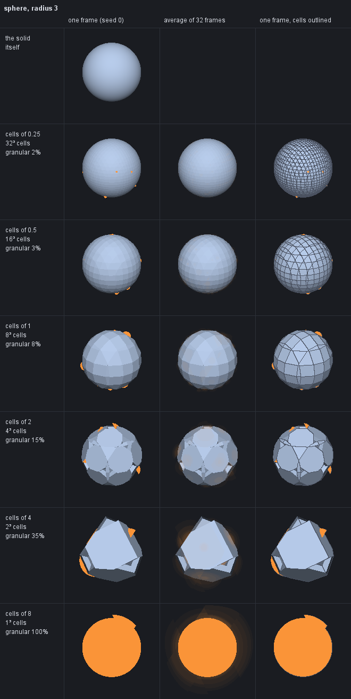
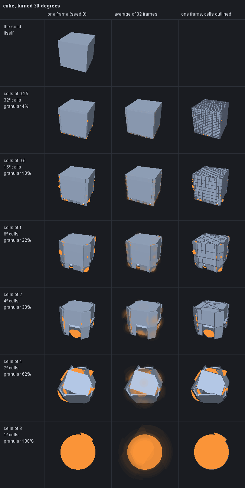

# vexelray-fields

Shapes as fields. Signed distance fields (SDF), multi-channel ones (MSDF, MTSDF), and **vexel fields**, an
experiment in keeping the probability of a hit and what the surface is like where it is hit, instead of one distance.

Plain Java 25, no dependencies, no GPU and no native code. A field is made here and drawn by whoever uploads it: the
bytes are `vexelray-canvas`'s `DistanceField` layout, and the kinds are `vexelray-codec-asset`'s.

```
mvn install        # build, test, and put it in the local Maven repository
```

## Modules

```
vexelray-fields-core    shapes (lines, quadratic and cubic Béziers; SVG path data), the nonzero fill by scanline,
                        Field (the floats), Framing (shape units to texels), Encoding (the bytes) and LogEncoding (the
                        bytes in log space, experimental), Coverage (drawn back on the CPU, as the shaders draw it).
vexelray-fields-sdf     one true distance per texel: ShapeSdf from a shape's edges, MaskSdf from a raster mask by an
                        exact Euclidean distance transform.
vexelray-fields-msdf    three distances whose median is the edge (Chlumský's MSDF), and MTSDF with the true distance
                        in a fourth: edge colouring, generation, sign and clash correction.
vexelray-fields-art     art made into any of the three: an SVG (drawn here, in Java), a black-and-white raster, or one
                        channel of a raster, such as its transparency. ArtField is the front door.
vexelray-fields-atlas   fields assembled into textures: GridAtlas (cells on grids, as the icon sets), ArtPair (a mark's
                        field beside its colour) and AtlasPixels (the deflated file vexelray-text's AtlasPixels reads).
vexelray-fields-vexel   experimental. Vexel fields: collision rate, granularity and materials per cell, filtered by
                        combining moments, and collided with by hashed rays that hold still frame to frame.
```

### Conventions

* Distances are **positive inside**, in **texels** in a `Field`, and kept unclamped until encoded.
* Texel `(x, y)` covers `[x, x+1) × [y, y+1)`, row 0 at the top, sampled at its centre. A `Framing` says whether the
  shape's y runs up (font units) or down (SVG).
* A distance `d` is encoded as `0.5 + d / range`, clamped: the edge at one half, `range / 2` texels each way the farthest
  a byte tells apart.
* A shape is filled by the **nonzero** rule. The sign of every distance comes from the fill, not from how contours
  happen to be wound, so overlapping contours and ones wound either way come out as they are filled.

### SDF, MSDF, MTSDF

```java
Shape star = PathData.parse("M50 0 L61 35 L98 35 L68 57 L79 91 L50 70 L21 91 L32 57 L2 35 L39 35 Z");
Framing framing = Framing.fit(star.bounds(), 32, 32, 3, false);

Field sdf   = ShapeSdf.generate(star, framing, 32, 32);
Field msdf  = Msdf.generate(star, framing, 32, 32);
Field mtsdf = Msdf.generateMtsdf(star, framing, 32, 32);

byte[] rgba = Encoding.rgba(msdf, 6);   // what the GPU uploads
```

What the MSDF buys, measured: the star above at 32×32 drawn at 16× has no clearly wrong pixels as an MSDF and 712 as
an SDF; at 16×16 drawn at 32×, 38 against 3,344 (`MsdfTest.magnifiedCornersStaySharp` holds the margin at ten
times).

The MSDF generator is msdfgen's legacy pipeline: simple edge colouring, per-channel nearest edge by true distance and
its pseudo-distance, then clash correction. Not yet here: msdfgen's newer error correction (which checks
interpolated values, not just neighbours), the overlapping-contour combiner (overlaps are handled by the sign pass
instead), and the ink-trap colouring.

### Log space (experimental)

A linear byte trades the edge against the reach. Range 16 spends its 255 steps on 8 texels each way, and a glow or a
shadow that wants 32 texels finds a flat 0 beyond them. Range 64 reaches 32, but every step is then four times as
coarse, at the edge too. `LogEncoding` spends the steps the way such effects need them: fine at the edge, a fixed share
of the distance far out.

```java
LogEncoding log = LogEncoding.matching(16, 32);   // as precise at the edge as linear 16, reaching 32: knee 2.45
byte[] rgba = log.rgba(sdf);
```

A distance `d` is stored as `0.5 + 0.5 * asinh(d / knee) / asinh(reach / knee)`. `asinh` is a straight line through the
edge, bending only with the cube of the distance, and is a logarithm beyond the knee. The edge stays at one half. The
curve is odd and rises, so an MSDF's median is unchanged by it. The shader filters and takes the median as before, then
decodes:

```glsl
float d = knee * sinh((e - 0.5) * 2.0 * asinh(reach / knee));
```

**Measured.** The README's star in a 128 × 128 field with a margin of 32, at eight rotations: a single framing lines its
straight edges up with the bytes and is off by a third either way. The bytes are filtered, then decoded, as a GPU
would, and checked against the float field. For an SDF:

| encoding                 | edge error at 4× | at 16× | of which filtering | distance error at 4–16 texels | 16–32  | 32–64  |
|--------------------------|-----------------:|-------:|-------------------:|------------------------------:|-------:|-------:|
| linear 16 (reach 8)      |            0.038 |  0.137 |                  0 |                    2.5 (gone) | 16 (gone) | 33 (gone) |
| linear 64 (reach 32)     |            0.142 |  0.368 |                  0 |                         0.064 |  0.062 | 9 (gone) |
| log, knee 2.45, reach 32 |            0.038 |  0.136 |              0.019 |                         0.064 |  0.157 | 9 (gone) |
| log, knee 1.90, reach 64 |            0.039 |  0.137 |              0.029 |                         0.082 |  0.202 |  0.340 |
| log, knee 0.95, reach 32 |            0.034 |  0.108 |              0.091 |                         0.080 |  0.202 | 9 (gone) |
| linear 8 (reach 4)       |            0.020 |  0.073 |                  0 |                    5.8 (gone) | 20 (gone) | 37 (gone) |

The edge errors are mean coverage errors over edge pixels; "of which filtering" is the error at 16× with the bytes left
unrounded. The distance errors are mean texels at texel centres, and "gone" means past the encoding's reach, clamped.
An MSDF comes out the same to within a few hundredths. What it shows:

* **At equal edge precision, log reaches four times as far.** The log encoding with a knee of 2.45 draws the edge as
  linear 16 does, and reaches 32 texels, where linear 16 has run out at 8. Linear 64 reaches as far but draws the edge
  3.7 times worse.
* **Reaching farther costs little.** Doubling the reach to 64 keeps the edge precision the same; the knee drops to 1.9,
  and the error far out grows by about a third. Far out the error stays under 1% of the distance.
* **Keep the knee above about two texels.** The GPU's filter blends bytes on the curve rather than on the distance.
  Within the knee the curve is nearly straight, so that costs nothing; with the knee under a texel it does, and the
  "of which filtering" column dominates. A knee of 0.95 matches linear 8's step and still draws the edge half again
  as coarsely as linear 8.

`FieldTest.logBytesReachFarAndKeepTheEdge` holds the encoding's own properties.

**Past the texture's edge.** Reach inside the texture is only half of it. An effect wider than the texture needs
distances where there are no texels, and a clamp-to-edge sampler gives it the edge's distance, flat, however far out.
But past the edge the whole shape lies on the texture's side, and that is enough to extrapolate. `Field.extended(u, v)`
does it as a shader would:

1. Step one texel in from the nearest point of the texture's edge.
2. Take the gradient there.
3. Follow it uphill by the distance there, to the shape's nearest point.
4. The distance is to that point, but never less than `√(out² + d²)`.

The point found is on the shape, so the result is never too near. No point of the texture is nearer than
`√(out² + d²)`, with `out` the way past the edge and `d` the distance at the edge. The extrapolation takes four more
reads, and only outside.

```glsl
// uv and size in texels; D(p) the filtered true distance at p, in texels
vec2 q = clamp(uv, vec2(0.5), size - 0.5), g = clamp(q, vec2(1.5), size - 1.5);
float d = D(g);
vec2 n = normalize(vec2(D(g + vec2(.5, 0)) - D(g - vec2(.5, 0)), D(g + vec2(0, .5)) - D(g - vec2(0, .5))));
float far = -max(length(uv - (g - n * d)), length(vec2(length(uv - q), D(q))));
```

Measured on textures cropped to a star, a disc and a bar with a margin of 8, sampled up to 96 texels outside, and checked
against true fields over the whole canvas. Mean error in texels, by distance past the edge:

|                         | 0–8  | 8–32 | 32–64 | 64–96 |
|-------------------------|-----:|-----:|------:|------:|
| star, clamp-to-edge     |  3.1 |   17 |    43 |    82 |
| star, `d − out`         |  1.1 |  3.5 |   5.3 |   5.6 |
| star, extended          | 0.22 | 0.93 |   1.7 |   1.9 |
| disc, extended          | 0.12 | 0.61 |   1.3 |   1.5 |
| bar, extended           | 0.01 | 0.01 |  0.02 |  0.02 |

* **The error is about 2% of the distance, and too far rather than too near.** A glow or a shadow comes out a shade
  fainter, never brighter. It is exact straight out from a straight edge.
* **Concave shapes are worst.** The star's worst point is 19 texels off: from far away a different arm is nearer than
  the one the edge texel pointed at. Each point found is an upper bound, so the nearest of several along the edge would
  tighten it.
* **The edge texels must hold true distances.** A star's texture corners are 28 texels from it, though its margin is 8.
  Encoded at range 16 they clamp, and every way of extrapolating then goes wrong by several texels. Within the texture
  the reach must cover its farthest edge texel.
* **Follow a true distance.** An MSDF's median is a poor gradient far from its edges; an MTSDF's fourth channel is the
  true distance, and `extended` follows that.

Together that suggests a split: an MTSDF's three edge channels linear and tight, its true distance in log reaching the
texture's corners, and `extended` past them. Not yet tried as one.

### Art: SVG, black and white, a channel

What `vexelray-gui`'s icon bake does through imagelib, here with nothing native. The art is fitted into
`width × height` texels with its aspect kept and centred, with `spread` texels of margin round it, as `DistanceField`
and the icon atlases lay a field out.

```java
Svg icon = Svg.read(Path.of("accept-mask.svg"));
Field sdf = ArtField.of(icon, FieldKind.SDF, 64, 64, 16);                    // where it is opaque

Raster scan = Raster.read(Path.of("logo.png"));                               // ImageIO: PNG, JPEG, BMP, GIF
Field ink   = ArtField.of(scan, Channel.LUMINANCE, false, FieldKind.SDF, 48, 48, 6);   // the dark, over white
Field cut   = ArtField.of(scan, Channel.ALPHA, true, FieldKind.MTSDF, 48, 48, 6);      // the transparent part
Field red   = ArtField.of(scan, Channel.RED, false, FieldKind.SDF, 48, 48, 6);         // one channel of a texture
```

| Channel | The shape is |
|---|---|
| `AUTO` | `ALPHA` if any pixel is less than opaque, else `LUMINANCE`; always `ALPHA` for an SVG |
| `ALPHA` | where it is opaque, whatever its colour |
| `LUMINANCE` | where it is dark, laid over white first, so a transparent background is background |
| `RED`, `GREEN`, `BLUE` | where that channel is high, alpha ignored |

`invert` takes the other part. A raster is read between its pixels before the shape is cut at one half, so a 32 px
drawing becomes a clean-edged shape rather than its staircase.

Two routes, by what the art has. An SVG of opaque fills alone whose fills do not overlap has its outline read exactly
(`Svg.outline`), and its SDF is `ShapeSdf`'s, its MSDF and MTSDF `Msdf`'s, corners sharp. Anything else is a mask
drawn at 8 pixels a texel and made into a true distance by `MaskSdf`; a mask has no edges to colour, so its MSDF is
that one distance in all three channels and its MTSDF in all four, the layout a multi-channel reader expects with an
SDF's round corners. That is what the framework's icons are today.

`Svg` draws fills, strokes (caps, joins, miter limits, dashes), masks and clips in user space, opacity, transforms,
`use`, linear and radial gradients, and properties as attributes or in `style`. Text is left out, as the icon bake
leaves it out of a silhouette. Images, patterns, filters, markers, style sheets and nested `svg` are refused by name
rather than drawn wrongly. A stroke under a transform that stretches one way more than the other is drawn at its mean
width. `render(w, h, samples)` antialiases, for art shown as it is.

Measured against the framework: the 125 large icons of `vexelray-gui-icons`, baked here at its cell (64 + 16), differ
from its atlas by 0.02 of 255 per texel on average, 0.18 in the worst cell. Of the 1,291 SVGs in `vexelray-icons`
and `vexelray-gui-icons`, every one that is a drawing converts; the one refused is a sprite sheet of symbols.

Not here: tracing a raster into outlines (so a raster's or a stroked SVG's MSDF has sharp corners), and stroking
into outlines for the same reason.

### Atlases

How `vexelray-gui-icons-maven-plugin` assembles its textures, without the Maven goals and the generated enums around
it.

```java
List<Grid> grids = List.of(Grid.SUITE_LARGE, Grid.SUITE_SMALL);      // 64 + 16 over 48 + 12
List<Entry> entries = names.stream().map(n -> Entry.of(n,
        ArtField.of(Svg.read(large(n)), FieldKind.SDF, 64, 64, 16),
        ArtField.of(Svg.read(small(n)), FieldKind.SDF, 48, 48, 12))).toList();
GridAtlas atlas = GridAtlas.bake(entries, grids, null);               // null: as near square as fits
atlas.pixels().write(Path.of("icons.rgba"));                          // written only if it changed

ArtPair logo = ArtPair.bake(Svg.read(art), 128, 0.6f, new int[]{52, 104, 156, 208}, "orb");
```

* `GridAtlas`: each grid's cells fill whole rows in order and the grids stack, first on top; the width is the one with
  the shortest longest side, then the least texture, within the 4096 every Vulkan device takes. A cell is written as
  `DistanceField` lays a field out (`0.5 + d / 2·spread`), and texels no cell writes read as far outside. The file
  families' fixed eight columns are a width of eight cells.
* `ArtPair`: the field in the MTSDF layout at two ranges (alpha over the whole margin, RGB over an eighth of it), the
  colour premultiplied and antialiased beside it, one atlas per size, and the `.pair` descriptor; a lifted part is left
  out of the field and its place recorded.
* `AtlasPixels`: `VXPX` (RGBA) or `VXPC` (any channel count, 1 or 4 read), then the texels deflated.

Measured against the framework: the suite's atlas rebuilt here is its size (1344 × 1368), every one of its 125
icons is in the same cell, and its bytes differ by 0.021 of 255 on average. Re-encoding the framework's own texels
gives its `icons.rgba` byte for byte. The framework's logo pair: the same descriptor, fields within 2 of 255, colour
within 0.24 on average (antialiasing at edges differs).

Not here: the font atlases, which msdf-atlas-gen packs, and the plugin's build-side work (stamps, generated sources).

### Vexel fields (experimental)

A field describes solid, never sheets. A surface is the face of solid: the floor of a level has infinite depth behind
it, a wall is a prism, and nothing is a plane with no thickness. A ray is stopped where it goes from free space into
solid, and never where it leaves.

A vexel field says, per cell, how likely a ray is to collide there and with what:

| per cell | what it is |
|---|---|
| granularity | `1` is smoke, material building up over distance with no particular normal; `0` is a surface, where the collision is at one point with one normal. Between, the cell is both. |
| rate | collisions per unit distance travelled, for the granular share |
| plane, footprint, depth | the flat share: a prism of solid behind the plane, within the footprint, as deep as its share of the cell's solid |
| materials | the chance of each material, given a collision |

The two shares compete along a ray: the granular share's collision falls where an exponential of its rate puts it,
the flat share's where the ray enters its prism, and whichever comes first is the collision. The rate is per distance
because granular material is met more the further a ray goes through it; the prism is met once, where it is entered,
through its face, its sides or a cell's wall alike.

All of that is derived from moments the cell keeps underneath: how much of it is solid, and the centroid and spread
of that solid; its surface area, the area-weighted mean of the surface's normals, where the surface sits along that
mean and how far it strays, and the centroid and covariance of where it lies; the share of each material, and the mean
and variance of any continuous attributes. Moments average exactly, which distances do not, so `coarser()` combines
eight cells into one (four in 2D) by moments, never by resampling: volume, area, material shares and centroids are
kept exactly, and detail lost to distance turns into granularity.

The flat share's prism: its face is a box on the plane from the surface's centroid and covariance (half-widths
`√(3·variance)`, the box a uniform rectangle's moments give back exactly), grown until it holds the flat area within
the plane's slice of the cell, and taken as the whole slice once it holds 85% of it, so a surface spanning its cell
keeps every corner and no crack opens between cells. Its depth is its share of the cell's solid over its face's area:
a floor's reaches the cell's far wall, a coarse cell's piece of a sphere stops short.

The granular share is grains of solid, as stochastic geometry's Boolean model has them. A ray from the free space
between grains enters one at a rate of `S/4 ÷ (1 − occupancy)` per unit distance in 3D (`S/π ÷ (1 − occupancy)` in
2D), so a mostly solid cell stops a ray almost at once. That rate is spread over the cell as a Gaussian at the solid's
centroid with the solid's spread, so a ray through a coarse ball meets it and one past its edge does not.

The solid as a whole counts too: each cell treats its solid as a ball at its centroid whose mean squared radius is its
spread, clipped to the solid side of the cell's plane where it has one, and a ray entering that ball is stopped with
the ball's fill (`solidFill`), `1` for a solid ball and toward `0` for a solid scattered thin, as foliage is.

The walk keeps whether the ray is in solid, as each cell describes it: in a cell's prism, in a granular cell's ball
when that is at least half full, or in a cell with no surface that is at least half solid. A ray that comes to a cell
in solid is leaving it and is not stopped there; one that comes into solid at a cell's wall is stopped at the wall.

A sphere of radius 3, baked in cells of 0.25 and coarsened, with vertical rays over it: the mean chance of a stop for
rays inside its outline (want 1) and outside it (want 0), and its mean granularity.

```
cell   granularity   inside   outside
0.25   0.015         1.000    0.000
0.50   0.034         1.000    0.000
1      0.077         1.000    0.001
2      0.149         1.000    0.009
4      0.350         0.999    0.077
8      1.000         1.000    0.067    one cell
```

Two ways to ask a ray. `trace` gives the expected outcome, the chance of a collision in each cell. `collide` gives one
outcome, every value it draws a `VexelHash` of the cell, the ray's direction quantized to an angle bucket, a seed and
what is being decided, so the outcome holds still from frame to frame while the view stays in its bucket. The grain is
the cell: a cell whose granular share stops a ray half the time is wholly there or wholly not, from one bucket; its
prism draws nothing, being solid. Averaged over seeds, `collide` agrees with `trace`
(`hashedCollisionsAverageToTheExpectedOutcome`).

What it looks like: `VexelPreview` draws a field on the CPU, one hashed `collide` per pixel. Grey-blue is a stop on a
flat share, lit by the face it entered; orange is a granular stop, which has no normal. Each row is a level, from the
solid itself down to one cell; the columns are one frame, the average of 32 frames (what accumulating frames converges
to) and one frame with the cells outlined.

| | |
|---|---|
|  |  |

Read off them: fine levels are faceted by one plane a cell; at cells of 2 and 4 each cell is a prism, and its sides
show; at one cell the solid is a granular ball, its edge where its solid would end, with a notch where the angle
buckets change. The cube at cells of 1 and 2 has a slot at its bottom edge where a ray clips a cell 85% solid but
misses its prism, its granular blob and its ball alike: the one-blob-per-cell limit below.

Known:
* The 85% at which a footprint becomes the whole slice is tuned on one sphere: at 80% the leak came back at cells of 2,
  at 90% cracks opened at cells of 1.
* A prism is a rough shape for three faces meeting at a corner: a cube turned 30° leaks 0.124 outside its outline at
  cells of 4 (0.994 inside), and a curved-triangle cap a little past its corners (the 0.077 above).
* One Gaussian per cell: solid in several clumps (eight grains in a cell's corners) is put in one blob between them,
  and a ray through the empty middle is stopped by the granular share about 30% of the time.
* The Gaussian's tails past the cell's walls are lost, so a cell whose solid is spread wide undercounts its rate.
* The rate's free share is the cell's average occupancy, not the occupancy where the ray is.

Experimental: the cell's layout, the derivation and the bake are expected to change.
